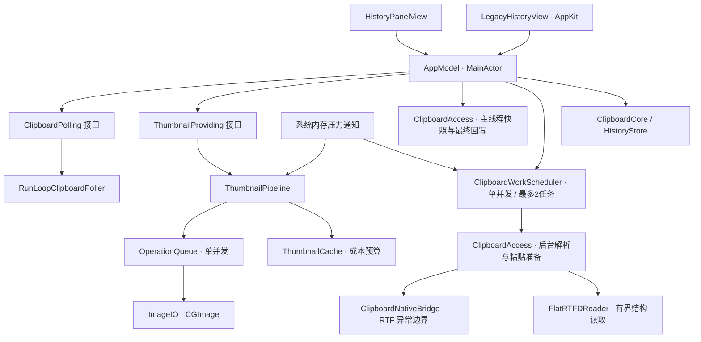

# 剪贴匣的调度与扩展边界

当前版本：0.1.8。目标是保持原生、轻量和可测试，把调度和资源管理从界面状态中分离。当前没有引入第三方运行时依赖。

## 当前依赖关系

- **AppModel**：界面状态、用户操作编排、复制版本判断。通过构造器注入轮询器和图片服务；测试可以替换实现。
- **PanelContent**：14+ 选择原 SwiftUI 界面，10.15–13 选择 AppKit 界面。旧界面使用按需创建行的 NSTableView，缩略图仍通过 ThumbnailPresentation 获取；隐藏时释放行及图片展示引用，不额外启动轮询器。
- **ClipboardPolling**：只定义启动、停止和运行状态。默认实现保留 0.6 秒间隔、0.1 秒容差；重复启动不创建第二个定时器，停止释放回调。暂停期间的复制是否忽略等业务规则留在 AppModel。
- **ThumbnailProviding**：界面只请求图片、清理记录和切换活动状态，不直接选择线程、操作队列或解析 ImageIO。
- **ThumbnailPipeline**：独立管理请求、排队、取消、解码、缓存及内存压力。后台只拿 URL 和请求标识，不跨线程访问 AppModel、HistoryStore 或 NSPasteboard。
- **ThumbnailPresentation / HistoryThumbnailView**：视图出现时请求，消失时释放图片。已显示图片由当前展示状态持有，完成通知只补齐缺图；缓存逐出不会触发所有行重新解码。失效代次变化会清除这些展示引用。
- **ClipboardCore**：历史数据、去重、容量、原子提交和格式侧文件。不依赖 AppKit 或 SwiftUI；不含 RTFD 时写 v2，含 RTFD 时写 v3；读取 v1/v2/v3。旧版会拒绝 v3，避免误删无法识别的记录。
- **ClipboardNativeBridge**：很小的 Objective-C 模块，将旧式 RTF 解码留在 `@try/@catch` 内，返回文字或格式失败。启用 `-fobjc-arc-exceptions`，让异常展开也执行 ARC 清理，见 [Clang ARC 异常说明](https://clang.llvm.org/docs/AutomaticReferenceCounting.html#exceptions)。
- **FlatRTFDReader**：RTFD 不调用系统 `NSFileWrapper` 反序列化。第二轮测试发现，该接口可能在抛异常之前按损坏长度保留巨额虚拟分配。当前 Swift 读取器仅接受已验证的 v0 平铺普通文件结构：数量、名称和长度在分配前核对，每块及根目录信息完整消费；拒绝重复、嵌套、链接及未知元数据。原始字节仍用于粘贴；未知结构回退其他有效表示或拒绝，不猜测解析。

## 存储异常与读取边界

加载历史时核对字节数、正复制次数、文字摘要、唯一 ID 和内容摘要；遇到不一致的数据拒绝加载，保留原文件。复制计数达到整数上限后保持上限，不溢出。重新复制图片时按 64 KiB 分块比较原始文件，发现缺失或损坏才原子修复，并保留条目与固定状态。图片和富文本目录不能是符号链接。

重新复制还会从新副本重建尺寸、字节数、格式列表等派生元数据。图片修复成功后仅清理该内容的缩略图缓存、失败记忆和旧请求；可见视图按复制时间变化重新取图，离屏视图不启动解码。

JSON 索引默认另有 640 MiB 的序列化上限：读取前检查文件大小和描述符，读取本身也有限额；写入后检查精确编码大小，失败不提交新历史。此上限为控制字符转义预留空间，与 100 MiB 原始内容预算不同。它不限制 JSON 解码、临时编码缓冲或整个进程的内存。测试通过较小的可注入额度验证写入失败，通过稀疏文件验证超大索引预检。

## 快捷键注册与冲突提示

- `HotkeyBackend` 封装系统事件监听和注册；`GlobalHotkey` 管理注册令牌、事件路由与替换，`AppModel` 管理已保存设置、实际启用状态和持续提醒。界面不直接调用 Carbon。
- `CarbonHotkeyBackend` 仅在注册时调用 `CopySymbolicHotKeys` 检查已启用的系统快捷键，再以 `kEventHotKeyExclusive` 注册。默认非独占注册允许多个应用共用组合键，因此不能单靠默认注册结果判断占用。
- 注册返回明确的错误类型：组合键被占用、系统快捷键冲突、监听安装失败或其他系统错误。系统快捷键枚举不含所有应用菜单快捷键，也不能发现所有自定义事件拦截；不推断占用应用名称。
- 先注册新组合，再注销旧组合；失败不更改旧注册和持久化设置。事件只接受当前注册 ID，旧注册的排队事件不会触发。取消令牌保证只注销一次。
- 启动失败与替换失败分开显示：没有可用快捷键时提示菜单栏入口；有旧快捷键时说明仍可用。设置允许重试同一组合键，事件监听初始化失败也可重试。提醒不依赖短时 toast，不增加定时器或后台扫描。
- 普通自检注入模拟后端，不注册系统按键；`--self-test-hotkey-system` 单独短暂注册罕用组合验证真实系统接口，结束时释放注册及监听，不发送按键。

## 10.15 部署与运行库

Intel 构建目标为 macOS 10.15，Apple Silicon 为 11.0。现代 SwiftUI 视图以 `@available(macOS 14.0, *)` 隔离，仅在运行时通过可用性判断创建；旧系统使用 AppKit 界面及绘制的菜单栏图标。共享格式和存储通过 `BoundedFileReader` 执行限额、可抛错的 POSIX 读取，避免要求 10.15.4 的 FileHandle API。

Swift 并发支持回部署到 Catalina，见 [Apple Xcode 13.2 发布说明](https://developer.apple.com/documentation/Xcode-Release-Notes/xcode-13_2-release-notes)。构建脚本使用工具链的 `swift-stdlib-tool` 嵌入并签名并发兼容运行库，保留系统 Swift 运行库优先、应用 Frameworks 回退，并删除本机构建工具链路径；不打包用户记录。检查通用二进制和运行库架构、最低系统声明、签名及 DMG 解包完整性。

当前只有新系统主机，10.15 兼容性编译、旧 UI 在当前主机的运行测试与实际 Catalina 运行验证是不同证据；后者尚未完成。

## 图片任务与内存规则

1. 主线程查缓存；未命中时返回占位并安排后台解码，不等待磁盘和 ImageIO。
2. 列表按 728×244 像素框（当前 364×122 pt 卡片 @2x）等比例下采样，预览保持最长边 600 像素；不放大原图，EXIF 旋转先换算展示尺寸。缓存与请求键包含原内容摘要和用途，两种尺寸共用总预算。
3. 默认一个 utility 队列执行解码，运行中和等待中的请求合计最多 8 个；同一个 key 的重复请求合并。任务只持有小型描述信息，不预读整批图片 Data。
4. ImageIO 在后台产生 CGImage，完成后回主线程创建 NSImage、更新缓存和通知视图。
5. 隐藏面板、清空记录、删除条目或内存压力变化都可以取消相关请求。每个结果带请求标识和失效代次，旧结果不能重新填入已经清空的缓存。
6. 同步 ImageIO 解码不能保证强制中断。取消主要停止待执行工作；运行中的解码完成后会丢弃过期结果。
7. 默认缓存成本预算 12 MiB、最多 32 张，最久未使用的图片优先淘汰。预算只约束缓存记账成本，后台解码、AppKit、可见视图持有的图片与进程其他内存不包含在内。
8. 系统发出 warning / critical 内存压力时清理缓存、取消待执行任务并暂停新加载；收到 normal 后才恢复，避免刚清理就立即重新填满。
9. 解码失败在当前状态下有界记忆，避免 SwiftUI 重绘不断重试；明确清理或重新激活后可以重试。队列满不等于图片失败，后续有空位时仍可请求。

## 格式任务与粘贴事务

- `snapshot(from:)` 只在主线程取单次复制的值数据，读前、读后校验 changeCount 和敏感标记。解析、图片转换和粘贴准备交给独立 `ClipboardWorkScheduler`，主线程只负责最终回写和界面状态。
- AppKit 的类型列表也会包含自动转换结果。富文本快照先通过公开 Pasteboard Manager 查询来源格式标记，仅读取底层存在且非系统翻译的表示；无法确认时放弃本次快照，由原轮询重试。明确提供的纯文字优先保留，否则后台从 RTF / RTFD 提取，避免主线程触发系统格式转换。
- 调度器默认单并发、完成回调按提交顺序交付、最多 2 个未结束任务、保留输入计费最多 50 MiB。Operation 依赖保证 FIFO；取消中的运行任务仍占用名额和字节预算，直到实际结束。待运行任务取消时释放输入；取消通知使 UI 退出准备状态。
- 单次采集快照与粘贴准备结果各最多 25 MiB；富文本表示合计 4 MiB，文字 1 MiB，图片 20 MiB / 16 百万像素。RTFD 仅接收 TXT.rtf 和最多 32 个静态 PNG/TIFF/JPEG 附件，总像素不超过 16 百万。已保存的大图核验原 PNG 字节摘要后直接回写；兼容旧版 16–40MP 历史，无须整图解码。仅在保守估算 TIFF 能装入输出预算时解码添加 TIFF 表示。
- 来源有富文本类型时不获取其图片预览；富文本副本超额时跳过该类型。纯图片通过轻量容器元数据选首个可用表示，不拉取全部副本；后续像素解码失败时拒绝该记录。
- 内存 warning/critical 时取消并停止接收新任务，normal 时恢复。输入预算不包含解码像素、系统剪贴板服务、输出、缩略图或 AppKit 内存，不是进程总内存硬上限；高位深图像的解码成本还可能更高。
- 压力取消尚未保存的采集时，记录轻量重试标记；恢复后重新读取最新剪贴板，即使复制版本未变化。主动清空、暂停或停止监听会清除标记，避免恢复被用户丢弃的旧操作。
- 单条删除不取消无关采集；把该摘要加入现有采集、对应重试及尚未获准入队的当前复制版本，在 `HistoryStore.add()` 写侧文件和提交前拒绝匹配内容。排除集合跟随该复制版本，完成、取消或版本变化后释放；未来新复制不继承排除状态。
- 面板等待最新采集时，压力重试和队列满尚未取快照的复制也算未完成状态，默认回车不触发旧记录粘贴；用户明确选择旧记录可继续操作。重试成功、拒绝或失败后结束等待。
- 清空持久化成功后才取消采集并推进当前剪贴板基线，防止清空前未取快照的复制重新入库；清空保存失败时保留待处理采集。
- 队列满时不再取快照、不推进复制版本号，下次轮询重试最新内容。与 0.6 秒轮询一样，不保证捕获极快速连续复制的每个中间状态。
- 暂停、停止监听、清理历史会使待处理采集结果失效。准备粘贴时记录目标剪贴板版本；用户期间产生新复制、删除条目、关闭面板或切换应用，会取消过期的自动回写。文件引用在准备和最终回写前各检查一次。

## 仍同步执行的边界

系统剪贴板字节读取和最终写回仍在主线程。来源应用可能延迟提供数据，读取前无法知道表示的大小，因此不能保证来源 IPC 的延迟或瞬间分配上限。`HistoryStore.add()` 的哈希、JSON 编码、原子写盘以及清理仍在主线程串行执行；本轮并未把存储变成后台服务。

## 后续扩展顺序

当性能采样显示采集或存储开始影响交互时，按以下边界拆分：

1. **ClipboardReader / Writer**：当前已拆分快照、处理和回写；后续保持这个线程边界，不跨队列共享 NSPasteboard。
2. **FormatProcessor**：当前后台解析集中在 ClipboardAccess。格式种类继续增加时，再引入按类型注册的处理器接口，不让 UI 承担格式判断。
3. **HistoryRepository**：串行提交存储操作，确保保存、删除、清空和固定之间的顺序；持久化成功后向 UI 发布新快照。替换 JSON / plist 或引入 SQLite 时保持上层语义。
4. **独立功能服务**：搜索索引、OCR、同步分别拥有取消标识、队列预算和缓存，按实际需要建立接口，不共用无界后台队列。

Swift actor 适合保护共享状态，但在 await 处可能重入，不能把它直接当成 FIFO 数据库事务队列。优先级也不等于并发或内存上限；任何队列都需要明确等待上限和数据所有权。

## 参考框架与取舍

| 参考 | 解决的问题 | 本项目采用的方式 |
| --- | --- | --- |
| [Swift Concurrency / actor](https://docs.swift.org/latest/documentation/the-swift-programming-language/concurrency/) | 隔离、任务生命周期与异步接口 | UI 使用 MainActor；未来异步存储另行设计事务顺序 |
| [OperationQueue](https://developer.apple.com/documentation/foundation/operationqueue/maxconcurrentoperationcount) | 同步工作的后台执行与并发限制 | 用于 ImageIO；额外限制等待请求数，不能只设置最大并发数 |
| [Nuke 队列配置](https://github.com/kean/Nuke/blob/main/Sources/Nuke/Pipeline/ImagePipeline%2BConfiguration.swift) | 编解码后台执行与分阶段限并发 | 保留缩略图服务；新增独立格式队列，并增加任务数量和输入字节上限，未引入依赖 |
| [Maccy 剪贴板实现](https://github.com/p0deje/Maccy/blob/master/Maccy/Clipboard.swift) | 标准表示与不可持久化私有格式的边界 | 参考其 Microsoft OLE source 等类型避让经验；本项目只读取明确支持的标准表示，不读取 Word 私有对象 |
| [TCA](https://github.com/pointfreeco/swift-composable-architecture) | 状态、副作用、模块组合与测试 | 借鉴明确状态与依赖注入；当前不整体迁移，它也不是内存调度器 |
| [DispatchSourceMemoryPressure](https://developer.apple.com/documentation/dispatch/dispatchsourcememorypressure) | 系统内存压力通知 | 清理缓存并降低后续工作量，恢复后再允许加载 |

## 0.1.6 内存与速度参考

- [Nuke 的缩略图请求](https://github.com/kean/Nuke/blob/main/Sources/Nuke/ImageRequest.swift) 与 [Kingfisher 的 DownsamplingImageProcessor](https://github.com/onevcat/Kingfisher/blob/master/Sources/Image/ImageProcessor.swift)：在解码时直接生成目标尺寸，尺寸/用途参与缓存身份。本项目采用列表与预览两种固定用途，避免布局小数变化产生大量缓存键。
- [Nuke ImageCache](https://github.com/kean/Nuke/blob/main/Sources/Nuke/Caching/ImageCache.swift)：按真实解码成本并配合数量预算；本项目保留 12 MiB / 32 项和简单 LRU，没有照搬它面向通用图片应用的大默认预算或 CLOCK 实现。
- [Kingfisher MemoryStorage](https://github.com/onevcat/Kingfisher/blob/master/Sources/Cache/MemoryStorage.swift)：关注持有对象的生命周期。本项目继续在隐藏面板和内存压力时释放缓存及视图引用，不增加周期清扫计时器。
- [Nuke DataCache](https://github.com/kean/Nuke/blob/main/Sources/Nuke/Caching/DataCache.swift)：后台串行 I/O 与有界暂存值得用于将来的存储拆分，但延迟落盘及可丢缓存语义不适用于用户剪贴板历史。当前历史仍在持久化成功后更新 UI。

以上为设计参考，没有复制其实现或新增依赖。列表方图/竖图会明显减少输出像素；超宽图可能因 728 像素显示宽度而比原 600 像素稍大，不能宣称所有比例都省相同内存。缓存成本不等于整个进程内存峰值。

## 验证方式

`bash scripts/test.sh` 验证核心存储与格式兼容；`.build/release/ClipboardDeck --self-test` 使用临时目录和命名剪贴板验证格式回写、原生文本与文件读取端，以及调度生命周期。新增调度测试应检查实际行为：串行度、等待上限、取消后的迟到结果、内存压力、失败重试和对象释放。

原生快捷键独占注册、同进程重复冲突与释放重试已通过单独探针验证；跨应用按键触发、真实 Word / Finder / 浏览器等应用中的完整交互仍需单独实测。模拟调度测试和图片缓存预算不能代替完整 GUI 进程的内存峰值测量。
